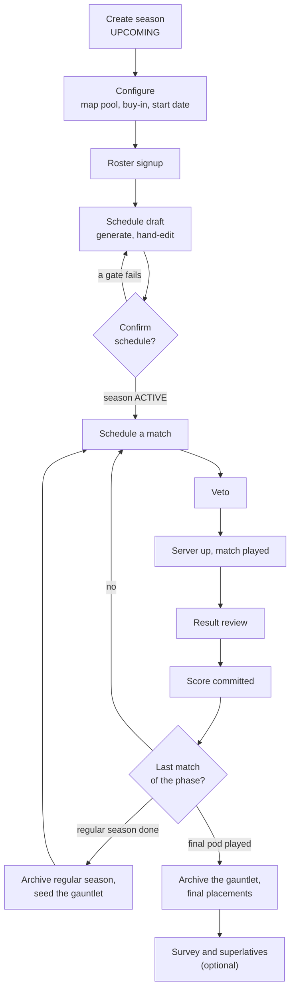
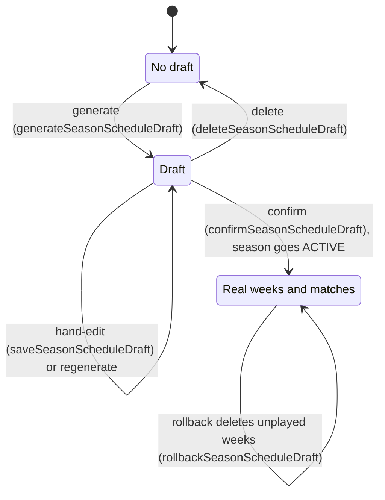
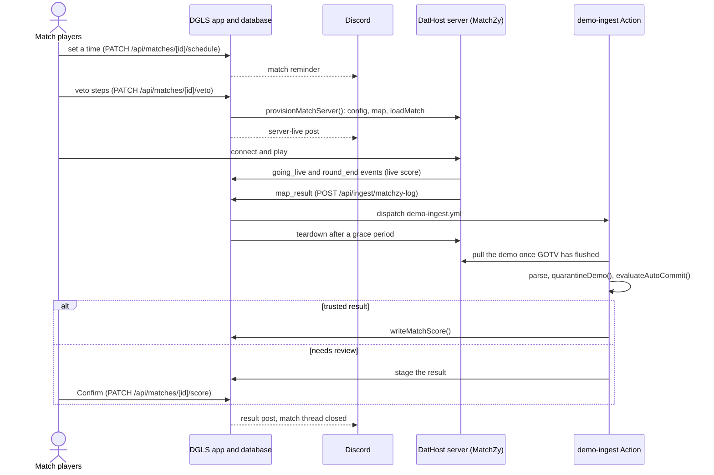

# Season Lifecycle

How a DGLS season runs from creation to archive: the stages in order, who acts at each one, what
gates it, and which code runs it. This is the process view. The detail lives in the owning docs:
[`architecture.md`](./architecture.md) (routes, their preconditions, schema, season status, the
gauntlet bracket), [`hosting.md`](./hosting.md) (the game server and the result pipeline) and
[`calculations.md`](./calculations.md) (rankings); domain terms are in [`glossary.md`](./glossary.md).

## At a glance

Three things move a season forward without anyone pressing a button: confirming the schedule makes
it `ACTIVE`, every committed score recomputes standings and ratings, and the last score of each phase
starts the next. The status transitions themselves are drawn in
[`architecture.md`](./architecture.md#season-status-lifecycle).

## Setup (`UPCOMING`)

| Stage | Who | Gate | Code |
|---|---|---|---|
| Create season | Admin | — | `POST /api/seasons` names it with `nextRegularSeasonName()` |
| Configure | Admin | Season `UPCOMING` for map pool and buy-in | `PATCH /api/seasons/[id]/map-pool`, `/buy-in`, `/start-date` |
| Roster signup | A player for themself, or an admin for anyone | Season `UPCOMING` | `POST`/`DELETE /api/seasons/[id]/players` |
| Schedule draft | Admin | Season `UPCOMING`; roster of `MIN_SEED_COUNT`–`MAX_SEED_COUNT` | `generateSeasonScheduleDraft()` → `buildRosterSchedule()`; hand-edits through `saveSeasonScheduleDraft()` |
| Confirm (go live) | Admin | Map pool set; `validateDraftIntegrity()` and `validateDraftCompleteness()` pass | `confirmSeasonScheduleDraft()`, then `activateSeason()` → `tryBuildGauntletShape()` |

A new player first registers through Steam sign-in (`POST /api/players/register`), creating a record
or claiming an existing one with an admin-issued link
([`architecture.md`](./architecture.md#auth-system)).

The schedule draft stays in its own tables until it is confirmed
([`architecture.md`](./architecture.md#tables), `season_schedule_draft_weeks`):

Rollback leaves the season `ACTIVE`, and the draft routes accept only an `UPCOMING` season, so a
rolled-back schedule can't be regenerated or confirmed again.

## Regular season (`ACTIVE`)

| Stage | Who | Gate | Code |
|---|---|---|---|
| Publish match threads | Admin | Discord configured | `publishWeekThreads()` |
| Schedule a match | Any of the match's 4 players, or an admin | — (`findScheduleCollision()` warns about a clash) | `PATCH /api/matches/[id]/schedule` → `scheduleMatchReminder()`; Discord events sync in through `syncSeasonScheduledEvents()` |
| Veto | A player on the step's faction, or an admin | Match unplayed; players only once it's scheduled and inside the veto window ([`glossary.md`](./glossary.md), Veto) | `PATCH /api/matches/[id]/veto`; `isVetoComplete()` |
| Server up, match played | System; a match player or admin can retry | The shared server is free (`findServerOccupant()`) | `provisionMatchServer()`; MatchZy events feed `live_match_score` ([`hosting.md`](./hosting.md)) |
| Result review | System; a match player or admin confirms or dismisses a staged result | `quarantineDemo()`, then `evaluateAutoCommit()` | `scripts/demo-ingest.ts`; `MatchDemoReviewBlock`; manual upload or entry in `DemoUploadModal` |
| Score committed | System | Veto complete; a played match only by an admin | `writeMatchScore()`, the one write path, which fires every post-score hook ([`hosting.md`](./hosting.md#trusted-auto-commit-138)) |

One match, end to end:

## Playoffs (gauntlet)

| Stage | Who | Gate | Code |
|---|---|---|---|
| Close the regular season | System | Every match in the season played (`isSeasonFullyPlayed()`) | `checkSeasonCompletion()` |
| Seed the gauntlet | System; admin as fallback | An unseeded bracket shape that matches the roster | `trySeedGauntlet()`; the admin fallback is `POST /api/seasons/[id]/gauntlet/seed` |
| Play pods | Players, as regular matches; an admin publishes pod threads | All 4 of a pod's slots filled | `resolveAndPropagate()`, `materializeIfReady()` → `materializePod()`; `publishPodThreads()` (one thread per pod) |
| Final placements | System | The final pod and every gauntlet match played | `checkGauntletCompletion()`; `canonicalGauntletRankMap()` orders the podium |

Bracket shapes are in [`architecture.md`](./architecture.md#gauntlet-bracket-scheduling); placement
rules are in [`calculations.md`](./calculations.md#canonical-gauntlet-ranking).

## Wrap-up

The post-season survey and superlatives vote are optional, opened and closed by an admin. Only
players with a played match in the season or its gauntlet can respond
([`architecture.md`](./architecture.md#post-season-survey-and-superlatives)).

## Who can act

Each mutation route checks one access gate ([`architecture.md`](./architecture.md#auth-system)):
`requireAdminAccess()`; `requireMatchAccess()` (an admin or one of the match's 4 players);
`requireSeasonRosterAccess()` (an admin, or a player for themself); `requireSeasonFeedbackAccess()`
and `requireSeasonFeedbackAdmin()`; a bare session for registration and self-service changes; and
`machine-auth.ts` for the game server's calls. Finer rules live inside the routes: the veto route
checks the step's faction, and only an admin can clear a veto step, veto outside the window, or
change a played score.

## Timers

The season has no deadlines or forfeits. These are the timers along the way; the symbol is the
source of truth, and the owning doc has the detail.

| Timer | Value | Defined by | Effect |
|---|---|---|---|
| Veto window | Opens 10 min before `scheduled_at` | `PATCH /api/matches/[id]/veto` | Players can't veto earlier |
| Match reminder | 1 hour before `scheduled_at` | `schedule_match_reminder()` (Postgres) | One Discord reminder per match whose time is set; a time synced from a Discord event reminds only a pod's Game 1 |
| Server clash warning | Under 1 hour apart | `SCHEDULE_COLLISION_WINDOW_MS` | Warning only |
| Pod Game 2 time | Game 1 + 30 min | `POD_GAME_GAP_MS` | Only for a time synced from a Discord event |
| Discord event sync | Every 15 min | `discord-event-sync.yml` | Copies a shared event's time onto the match |
| Teardown grace | 2.5 min | `AUTO_TEARDOWN_DELAY_MS` | Players see the final scoreboard first |
| Demo pull | Waits until 120 s after `map_result`, gives up after 8 min | `FLUSH_FLOOR_MS`, `FETCH_TIMEOUT_MS` | Never parses a half-written demo |
| Stale job | 45 min in flight | `STALE_IN_FLIGHT_MS` | Flagged stale, can be retried |
| Week window | 7 days per week from `start_date` | `weekWindow()` | Decides the current week; not a deadline |
