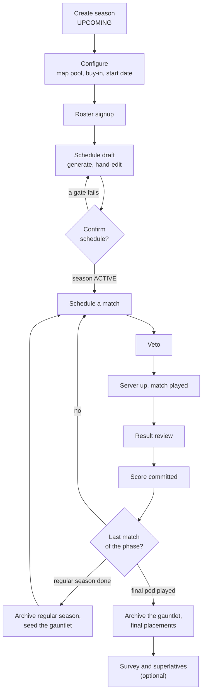
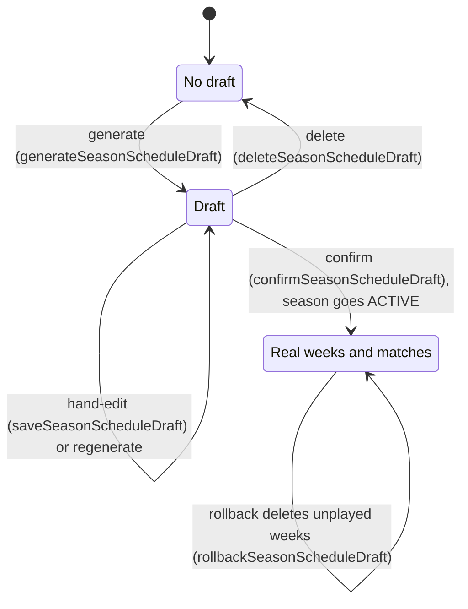
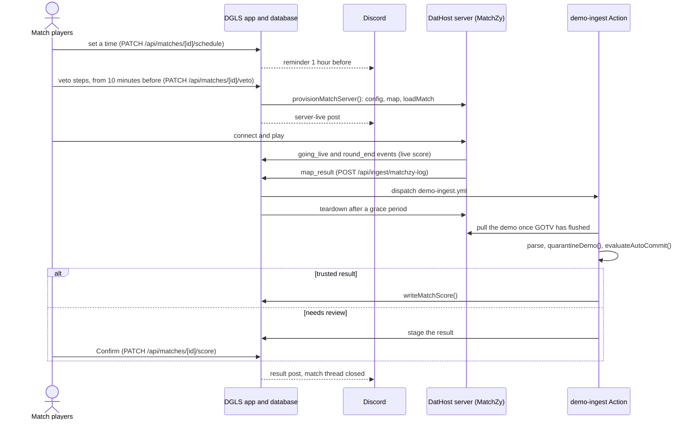

# Season Lifecycle

How a DGLS season runs from creation to archive: the stages in order, who acts at each one, what
gates it, and which code runs it. This is the process view. Each stage links to the doc that owns
its detail ([`architecture.md`](./architecture.md), [`hosting.md`](./hosting.md),
[`calculations.md`](./calculations.md)); domain terms are in [`glossary.md`](./glossary.md).

## At a glance

Three things move a season forward without anyone pressing a button: confirming the schedule makes
it `ACTIVE`, every committed score recomputes standings and ratings, and the last score of each phase
starts the next. The status transitions themselves are drawn in
[`architecture.md`](./architecture.md#season-status-lifecycle).

## Setup (`UPCOMING`)

| Stage | Who | Gate | Code |
|---|---|---|---|
| Create season | Admin | — | `POST /api/seasons` names it with `nextRegularSeasonName()`, sets `target_win_rounds` 13 |
| Configure | Admin | Map pool and buy-in: season `UPCOMING`, buy-in only until a schedule draft exists. Start date: any time | `PATCH /api/seasons/[id]/map-pool` (`parseMapPoolInput()`: empty or exactly `MAP_POOL_SIZE` maps), `/buy-in` (`set_season_buy_in()`), `/start-date` |
| Roster signup | A player for themself, or an admin for anyone | Season `UPCOMING` (`season_players_upcoming_only` trigger) | `POST`/`DELETE /api/seasons/[id]/players` behind `requireSeasonRosterAccess()`; grants or revokes `@Participants` |
| Schedule draft | Admin | Season `UPCOMING`; roster of `MIN_SEED_COUNT`–`MAX_SEED_COUNT` (7–19) | `POST /api/seasons/[id]/schedule` → `generateSeasonScheduleDraft()` → `buildRosterSchedule()`; hand-edits through `PATCH` → `saveSeasonScheduleDraft()`, checked by `validateDraftIntegrity()` |
| Confirm (go live) | Admin | Season `UPCOMING`; map pool set; `validateDraftIntegrity()` and `validateDraftCompleteness()` pass; no real weeks yet | `POST /api/seasons/[id]/schedule/confirm` → `confirmSeasonScheduleDraft()`, then `activateSeasonBestEffort()` → `activateSeason()` → `tryBuildGauntletShape()` |

A new player first registers through Steam sign-in: `POST /api/players/register` creates a record,
or links an existing one with an admin-issued claim link (`signPlayerClaim()`, see
[`architecture.md`](./architecture.md#auth-system)).

The schedule draft lives in its own tables until it is confirmed:

Generate, save, delete and confirm accept only an `UPCOMING` season; rollback has no status gate and
doesn't change the status. Every one of them runs as a single Postgres function under the season row's
lock ([`architecture.md`](./architecture.md#tables), `season_schedule_draft_weeks`).

## Regular season (`ACTIVE`)

| Stage | Who | Gate | Code |
|---|---|---|---|
| Publish match threads | Admin | Discord configured | `POST /api/seasons/[id]/discord-threads` → `publishWeekThreads()`, one thread per match of the given week (`'next'` = the first week with no played match) |
| Schedule a match | Any of the match's 4 players, or an admin | — (`findScheduleCollision()` warns when another match is under an hour away) | `PATCH /api/matches/[id]/schedule` → `scheduleMatchReminder()`; a Discord event shared in the thread syncs in through `syncSeasonScheduledEvents()` |
| Veto | A player on the step's faction, or an admin | Match unplayed and scheduled; players only from 10 minutes before `scheduled_at` | `PATCH /api/matches/[id]/veto`; order in [`glossary.md`](./glossary.md) (Veto); completion is `isVetoComplete()` |
| Server up, match played | System; a match player or admin can retry | No other match, scrim or console launch holds the server (`findServerOccupant()`) | `provisionMatchServer()`; MatchZy events to `POST /api/ingest/matchzy-log` feed `live_match_score` ([`hosting.md`](./hosting.md)) |
| Result review | System; a match player or admin confirms or dismisses a staged result | `quarantineDemo()`, then `evaluateAutoCommit()` | `demo-ingest.yml` → `scripts/demo-ingest.ts`; review in `MatchDemoReviewBlock`; manual upload or entry in `DemoUploadModal` |
| Score committed | System | Veto complete; a played match only by an admin | `PATCH /api/matches/[id]/score` or the Action → `writeMatchScore()` |

`writeMatchScore()` is the one write path for a score, and fires every downstream hook: the EHOG
recompute (`triggerRatingRecompute()`), the Discord result post and thread close, gauntlet
advancement (`resolveAndPropagate()`), and the completion checks below.

One match, end to end:

## Playoffs (gauntlet)

| Stage | Who | Gate | Code |
|---|---|---|---|
| Close the regular season | System | Every match in the season played (`isSeasonFullyPlayed()`) | `checkSeasonCompletion()` sets `ARCHIVED` |
| Seed the gauntlet | System; admin as fallback | A bracket shape exists, isn't seeded yet, and the roster hasn't drifted from it | `trySeedGauntlet()` (or `POST /api/seasons/[id]/gauntlet/seed`) fills seed slots from the final standings and materializes round 1 |
| Play pods | Players, as regular matches | All 4 of a pod's slots filled | `resolveAndPropagate()` advances survivors; `materializeIfReady()` → `materializePod()` creates the next pod's two matches; `publishPodThreads()` posts one thread per pod |
| Final placements | System | The final pod and every gauntlet match played | `checkGauntletCompletion()` archives the gauntlet (and the regular season if still `ACTIVE`); `canonicalGauntletRankMap()` orders the podium |

Bracket shapes by qualifier count are in
[`architecture.md`](./architecture.md#gauntlet-bracket-scheduling); placement rules are in
[`calculations.md`](./calculations.md#canonical-gauntlet-ranking).

## Wrap-up

The post-season survey and superlatives vote are optional, opened and closed by an admin from
Manage → Season once the season is past `UPCOMING`. Only players with a played match in the season or
its gauntlet can respond (`requireSeasonFeedbackAccess()`). See
[`architecture.md`](./architecture.md#post-season-survey-and-superlatives).

## Who can do what

Every mutation route checks one of these gates (`AccessResult`, `src/lib/access-control.ts`):

| Gate | Who passes | What it guards |
|---|---|---|
| `requireAdminAccess()` (`admin-access.ts`); `src/app/admin/layout.tsx` for `/admin/**` | `players.is_admin` | Season create, configure and delete; schedule generate, edit, confirm and rollback; gauntlet build, seed, reset and manual pods; Discord thread publish; feature-match toggle; player edits and claim links; EHOG recompute |
| `requireMatchAccess()` (`match-access.ts`) | An admin, or one of the match's 4 players | Schedule, veto, score, demo upload, dispatch and review, server provision, status and teardown, replay dispatch |
| `requireSeasonRosterAccess()` (`season-roster-access.ts`) | An admin for any player; a player for themself | Roster add and remove |
| `requireSeasonFeedbackAccess()` / `requireSeasonFeedbackAdmin()` (`feedback-access.ts`) | A player who played the season / an admin | Survey answers and superlative votes / survey and vote admin |
| A session only | Any signed-in player | Registration, self-service rename, Discord link and unlink |
| `machine-auth.ts` | The game server's shared secret | `GET /api/matches/[id]/matchzy-config`, `POST /api/ingest/matchzy-log` |

Inside `requireMatchAccess()`, a few steps are admin-only: clearing a veto step, vetoing outside the
10-minute window, and changing a score once the match is played.

## Timers

The season has no deadlines or forfeits; these are the only clocks in the process.

| Timer | Value | Defined by | Effect |
|---|---|---|---|
| Veto window | Opens 10 min before `scheduled_at` | `PATCH /api/matches/[id]/veto` | Players can't veto earlier |
| Match reminder | 1 hour before `scheduled_at` | `schedule_match_reminder()` (Postgres) → `POST /api/cron/match-reminder` | One Discord reminder (Game 1 only for a gauntlet pod) |
| Server clash warning | Strictly under 1 hour apart | `SCHEDULE_COLLISION_WINDOW_MS` | Warning only |
| Pod Game 2 time | Game 1 + 30 min | `POD_GAME_GAP_MS` | Only for a time synced from a Discord event |
| Discord event sync | Every 15 min | `discord-event-sync.yml` | Copies a shared event's time onto the match |
| Teardown grace | 2.5 min after `map_result` or the score write | `AUTO_TEARDOWN_DELAY_MS` | Players see the final scoreboard first |
| Demo flush wait | At least 120 s after `map_result`; 8 min overall limit | `FLUSH_FLOOR_MS`, `fetchDemoFromDathost()` | Never parses a half-written demo |
| Stale job | 45 min in flight | `STALE_IN_FLIGHT_MS` | Flagged stale on the review block and in the admin Activity feed, and can be retried |
| Claim link | Expires after 7 days | `CLAIM_TTL_MS` | The admin mints a new link |
| Self-service rename | Once every 7 days | `RENAME_COOLDOWN_MS` | — |
| Week window | 7 days from `start_date` per week number | `weekWindow()` | Decides the current week (`findCurrentWeek()`); not a deadline |
| Steam profile refresh | Daily | `vercel.json` cron → `GET /api/cron/refresh-steam` | Keeps avatars and nicknames current |
